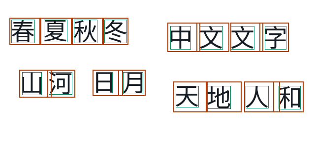

# 用 TextVerifier 训练单字字形

`train_vosr_ablation.py` 可以在解码后的 SR 图像上逐字计算 TextVerifier Stage-3 的连续误差。将裁片的视觉向量与目标字的 10 个原型做余弦比较，取 `1 - max(cosine_similarity)`。每个完整、可评分的字在当前微批次中权重相同。TextVerifier 的视觉编码器、投影层和原型冻结，梯度经过裁片和 SR 图像回传至学生模型。[模型与权重](https://huggingface.co/ATH-MaaS/TextVerifier-CJK-CLIP) · [官方评分实现](https://github.com/ATH-MaaS/TextVerifier/blob/b5df1bfe798a525b2b6ec1f948013abf99152b5c/textverifier/inference.py)

## 准备单字标注

在用于标注的 Python 3.11 环境安装 PaddleOCR。本次 A100 使用 CUDA 12.6 版 PaddlePaddle。执行以下命令时，当前目录为 VOSR 仓库根目录。

```bash
python -m pip install paddleocr==3.6.0 'paddlex[ocr-core]==3.6.1'
python -m pip install paddlepaddle-gpu==3.2.2 \
  --index-url https://www.paddlepaddle.org.cn/packages/stable/cu126/ --extra-index-url https://pypi.org/simple
python tools/annotate_glyphs.py --device gpu:0 \
  --hq-dir preset/datasets/RealCE_x4/train/HQ \
  --output preset/datasets/RealCE_x4/train/glyphs.json
```

脚本在原始 HQ 坐标系运行 `PP-OCRv5_server_det` 和 `PP-OCRv5_server_rec`，从 `return_word_box=True` 的识别对齐结果读取字和对应四边形。`--min-score` 是行识别置信度阈值，默认 0.8。`--det-model-dir` 和 `--rec-model-dir` 可指向本地模型目录。PP-OCR 以整词返回的多字符组计入 `skipped_groups`，无效几何计入 `invalid_boxes`。空图在 JSON 中显式记为 `[]`。[PaddleOCR 接口](https://www.paddleocr.ai/latest/en/version3.x/pipeline_usage/OCR.html)

每张训练图片对应一个键。每条有效且对齐的文字行须提供 `glyphs`，其中每个 `char` 对应一个原始 HQ 单字框。框接受 TL、TR、BR、BL 四角的 `quad` 或 `[x0,y0,x1,y1]` 的 `bbox`。行转写可供其他文字损失使用。

```json
{
  "page": [{
    "transcript": "中文",
    "bbox": [12, 16, 75, 48],
    "glyphs": [
      {"char": "中", "bbox": [13, 16, 41, 47]},
      {"char": "文", "bbox": [46, 17, 75, 48]}
    ]
  }]
}
```

## 配置训练

下载同一版本的权重和原型，在示例 YAML 中设置配对 LQ、HQ、标注和模型目录。

```bash
huggingface-cli download ATH-MaaS/TextVerifier-CJK-CLIP \
  textverifier_stage3.pth textverifier_k10_q90.pt \
  --revision adc233a117cbb039842b245b5acf84e0143a5f11 --local-dir preset/ckpts/TextVerifier
python train_vosr_ablation.py --config configs/ablations/loss/glyph_sft.yml
```

`training.glyph_loss_weight` 默认 0。示例取 1，与 `base_sft.yml` 的 GT 损失相加。只检验字形梯度时，把 `gt_weight` 和 `kd_weight` 均设为 0。`glyph_loss.batch_size` 控制每次视觉编码的字数，评分使用 FP32，并在反向时重算冻结编码器的激活。训练支持 latent 学生的 VAE 解码输出及 pixel 学生的 RGB 输出。[示例配置](../configs/ablations/loss/glyph_sft.yml)

训练器将标注平移到当前裁剪坐标，只取完整落在原图有效区域内的单字。已裁掉一部分的行仍可贡献其中的完整字。日志中的 `glyph_scored`、`glyph_unsupported` 是一个优化步内的计数。`glyph_loss` 是加权前的连续误差，DDP 跨 rank 按可评分字数归一化，梯度累积采用训练器的微批次均值。空微批次返回与学生计算图相连的零损失。启用时，训练器会检查所选图片是否具有单字标注，且至少有一个目标字在原型库内。

## Colab A100 验证

使用 NVIDIA A100-SXM4-80GB、PyTorch 2.5.1+cu121 和发布版 VOSR2 1.4B、DINOv2、Qwen-Image 2D VAE 权重。两张 320×320 合成中文页各含 8 个字，LQ 由 HQ 先缩小 4 倍再双三次放大得到。训练直接读取 PP-OCR 脚本输出的单字标注。学生采用 BF16，唯一优化目标为权重 1 的 `glyph_loss`，AdamW 学习率为 `1e-6`，权重衰减为 0。

| 优化步 | 字数 | glyph_loss | 解码图像梯度 L2 | 首块注意力 QKV 权重梯度 L2 | 学生总梯度 L2 |
| --- | ---: | ---: | ---: | ---: | ---: |
| 1 | 8 | 0.00185843 | 0.00089662 | 0.01061592 | 0.33235812 |
| 2 | 8 | 0.00139555 | 0.00098823 | 0.00292622 | 0.08927780 |

两步后，首块注意力 QKV 和输出线性层权重的变化量 L2 分别为 0.00385247 和 0.00041808。TextVerifier 有梯度的参数张量数为 0。训练完成 checkpoint 和推理导出，PyTorch 峰值显存分配为 28.93 GiB。另取 8 个字与官方 FP32 推理逐字比较，原生裁片的分数最大绝对差为 `7.81e-6`，输入同一张 128×128 裁片时为 `8.34e-7`。[完整指标和版本](glyph_a100_metrics.json)

PP-OCRv5 在同一块 A100 上处理了 TextRenderBench-ZH 的全部 299 张图片，含 7,127 个经人工复核的参考汉字框。按字相同且轴对齐框 IoU ≥ 0.5 做一对一匹配，7,110 个预测汉字框命中 6,440 个，精确率 **90.58%**，召回率 **90.36%**，F1 **90.47%**。指标包含 18 张参考汉字框为空的图片。此数据集仅用于评测标注脚本。[基准数据和标注说明](https://huggingface.co/datasets/ATH-MaaS/TextRenderBench-ZH)

在带已知笔画位置的两张合成页上，16 个字的字符标签全部正确，10 个预测框与笔画紧框的 IoU 达到 0.5，平均 IoU 为 0.555。下面的橙色为 PP-OCR 单字框，绿色为实际笔画紧框。另一张空白图输出 0 个框。商品说明图片的标题“纯臻营养护发素”输出了 7 个标签和对应字框。[商品图片](https://github.com/PaddlePaddle/PaddleOCR/blob/release/2.7/doc/imgs/11.jpg)


